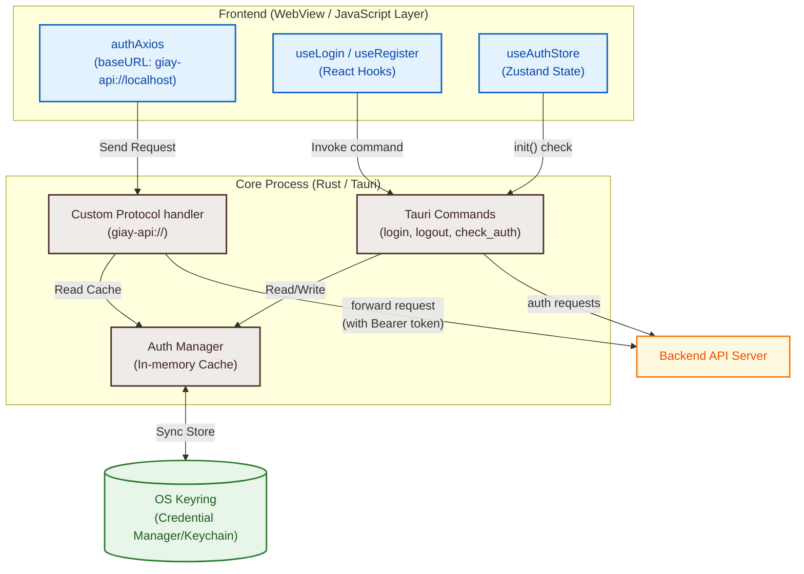
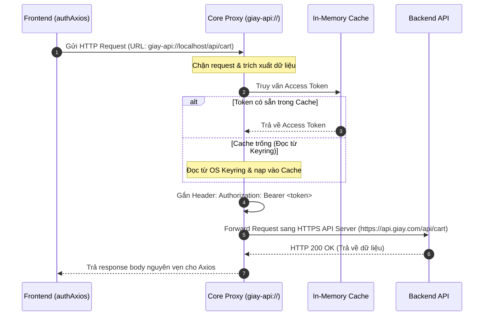

# Kiến trúc Xác thực An toàn (Secure Auth & Proxy Architecture)

## 1. Nguyên lý Thiết kế (Design Principles)

Để bảo vệ JWT khỏi nguy cơ bị đánh cắp qua tấn công XSS, token tuyệt đối không được xuất hiện tại lớp JavaScript (Renderer Process). Thay vào đó, chúng ta lưu trữ token an toàn trong Core Process bằng thư viện `Keyring` – nơi duy nhất có quyền truy xuất và quản lý (thêm/đọc/xóa) token. Lớp JavaScript chỉ được phép nhận biết trạng thái xác thực (đã đăng nhập hay chưa) thông qua việc kiểm tra sự tồn tại của token trong hệ thống.

Mọi yêu cầu API từ giao diện sẽ không gửi trực tiếp mà đi qua một Proxy nội bộ chạy tại Core Process. Proxy này có nhiệm vụ tự động trích xuất token từ `Keyring`, đính kèm vào header của request, rồi mới chuyển tiếp (forward) đến server. Cơ chế này đảm bảo mã độc JS không thể tiếp cận hoặc rò rỉ token dưới bất kỳ hình thức nào.

## 2. Sơ đồ Luồng Dữ liệu (Data Flow)

### 2.1 Sơ đồ Thành phần Hệ thống



### 2.2 Luồng Gọi API Xác thực (Authorized API Request)

Khi Frontend gọi một API cần xác thực (ví dụ: lấy thông tin giỏ hàng):



---

## 3. Các Thành phần Chính (Core Components)

### 3.1 Tauri Commands

- **Các câu lệnh:** `login`, `register`, `logout`, `check_auth`.
- **Cơ chế hoạt động:**
  - Khi người dùng đăng nhập/đăng ký thành công, Core Process nhận token từ Server, lưu trực tiếp vào OS Keyring và cập nhật cache.
  - **Chỉ trả về thông tin User và trạng thái thành công cho Frontend (void/boolean)**. Token tuyệt đối không được trả về JS layer.

### 3.2 Custom Protocol Proxy (`giay-api://`)

Tauri cho phép đăng ký một custom URI scheme. Chúng ta sử dụng `giay-api://localhost` làm baseURL cho client HTTP (`authAxios`) ở Frontend.

- **Định tuyến (Routing):** Mọi request gửi tới `giay-api://localhost/*` sẽ kích hoạt handler `handle_auth_api` phía Rust.
- **Đính kèm Token:** Handler tự động lấy token từ cache, đính kèm vào tiêu đề `Authorization: Bearer <JWT>` và gửi đi bằng client native `reqwest`.
- **Cơ chế Retry & Tự động Làm mới (Auto-Refresh):**
  Nếu Server trả về `401 Unauthorized`, Proxy ở Core sẽ tạm dừng hàng đợi request, gửi yêu cầu refresh token bằng `refresh_token` lấy từ Keyring. Nếu thành công, cập nhật lại Keyring/Cache và tự động gửi lại (retry) các request ban đầu với token mới mà không cần can thiệp từ phía Frontend.
- **Xử lý CORS:** Proxy tự động xử lý các request `OPTIONS` (CORS preflight) bằng cách trả về ngay lập tức HTTP status `204 No Content` với các headers CORS phù hợp, giúp loại bỏ các hạn chế CORS trình duyệt thông thường.

### 3.3 Auth State & Storage

- **OS Keyring (Bền vững):** Sử dụng thư viện `keyring-rs` để lưu trữ `access_token` và `refresh_token` an toàn vào keychain hệ điều hành (Windows Credential Manager, macOS Keychain, Linux Secret Service). Dữ liệu này tồn tại qua các lần tắt/mở ứng dụng.
- **In-memory Cache (Hiệu năng):** Vì việc truy xuất Keyring của hệ điều hành có độ trễ nhất định, Core Process duy trì một bản cache trong bộ nhớ (được bảo vệ bởi `RwLock` hoặc `Mutex`). Cache này được đồng bộ ngay khi ghi/xóa token ở Keyring.
- **Zustand store (Frontend):** Quản lý trạng thái giao diện. Chỉ lưu các biến flag: `isAuthenticated` (boolean), `user` (object thông tin cơ bản) và `initialized` (boolean). **Không lưu trữ bất kỳ token nào**.

---

## 4. So sánh các Giải pháp (Trade-off Analysis)

| Phương án                                                   | Mức độ Bảo mật | Ưu điểm                                                                                                                                                              | Nhược điểm                                                                                                                                          |
| :---------------------------------------------------------- | :------------: | :------------------------------------------------------------------------------------------------------------------------------------------------------------------- | :-------------------------------------------------------------------------------------------------------------------------------------------------- |
| **Token trong JS Layer** _(Local/SessionStorage, Variable)_ |  ❌ Rất thấp   | Cực kỳ đơn giản, dễ triển khai, thư viện hỗ trợ sẵn.                                                                                                                 | Dễ bị đánh cắp hoàn toàn nếu ứng dụng dính mã độc XSS hoặc thư viện bên thứ ba bị tấn công chuỗi cung ứng (supply chain attack).                    |
| **HttpOnly Cookie**                                         | ❌ Trung bình  | Tự động đính kèm bởi trình duyệt, chống XSS đọc token tốt.                                                                                                           | Bị chặn bởi cơ chế Intelligent Tracking Prevention (ITP) trên macOS (WebKit) nếu API và App khác origin. Dễ bị tấn công CSRF.                       |
| **Invoke Tauri Commands** _(Truyền token qua IPC)_          | ⚠️ Trung bình  | Bảo mật tốt hơn vì token lưu ở Rust, chỉ truyền lên JS khi cần.                                                                                                      | Tốn tài nguyên do JSON serialize/deserialize 2 chiều qua cầu nối IPC (gây trễ ~5-10ms mỗi request). JS vẫn chạm vào token tại một thời điểm nào đó. |
| **Custom Protocol Proxy** _(Giải pháp hiện tại)_            | ✅ **Tối đa**  | **Token không bao giờ tiếp xúc với lớp JS**. Sử dụng kết nối native HTTP cực nhanh (nhanh hơn IPC invoke ~4-7ms), tự động hóa toàn bộ cơ chế refresh token dưới nền. | Phải cấu hình custom protocol handler ở cả phía Rust và Axios.                                                                                      |

---

## 5. Hướng dẫn Tích hợp & Khởi tạo (Initialization Guide)

### 5.1 Khởi động và Xác thực Trạng thái

Hàm `init()` trong Zustand store (`useAuthStore`) bắt buộc phải được gọi **chỉ một lần duy nhất** khi ứng dụng khởi chạy (tại `main.tsx` hoặc trong router hook `beforeLoad`).

```typescript
// useAuthStore.ts (Mô phỏng logic khởi tạo)
export const useAuthStore = create((set) => ({
  isAuthenticated: false,
  user: null,
  initialized: false,

  init: async () => {
    try {
      // Gọi Tauri command để kiểm tra xem keyring có token hợp lệ hay không
      const user = await invoke("check_auth");
      if (user) {
        set({ isAuthenticated: true, user, initialized: true });
      } else {
        set({ isAuthenticated: false, user: null, initialized: true });
      }
    } catch {
      set({ isAuthenticated: false, user: null, initialized: true });
    }
  },
}));
```

> [!WARNING]
> Không được trì hoãn việc gọi `init()` hoặc chỉ gọi sau khi người dùng thực hiện hành động đăng nhập. Nếu làm vậy, khi người dùng khởi động lại ứng dụng, giao diện sẽ tự động chuyển hướng họ về trang `/login` mặc dù Keyring hệ điều hành vẫn đang lưu trữ token hợp lệ.

### 5.2 Cấu hình Axios Frontend

Đảm bảo tất cả các API client cần quyền truy cập (authenticated requests) được định cấu hình với scheme `giay-api://`.

```typescript
import axios from "axios";

export const authAxios = axios.create({
  baseURL: "giay-api://localhost",
  timeout: 10000,
});
```
