# Plan: Bảo mật Token — Custom Protocol Proxy

> **Ngày**: 2026-07-01
> **Trạng thái**: Chưa bắt đầu
> **Nền tảng**: Tauri v2 Desktop

## Tổng quan

Token JWT hiện chạm JavaScript (zustand + axios interceptor) → XSS có thể steal. Giải pháp: chuyển mọi request authenticated qua Custom Protocol Proxy trong Rust — token chỉ tồn tại trong Rust + Keyring.

```mermaid
flowchart TB
    subgraph FE["Frontend"]
        AX["authAxios<br/>baseURL: http://api.localhost"]
        YJS["Yjs"]
    end
    subgraph RUST["Rust (built-in)"]
        PROXY["Protocol Handler<br/>reqwest + Bearer từ Keyring"]
        KR[("Keyring")]
    end
    SV["Server"]

    AX -->|"fetch http://api.localhost"| PROXY
    PROXY --> KR
    PROXY -->|"reqwest"| SV
    YJS -.->|"WebSocket: dùng ticket (xem mở rộng)"| SV
```

**Kết quả:** Token không bao giờ có mặt trong JS memory, DevTools, hay bất kỳ layer nào của webview.

---

## Phase 1: Rust — Xây dựng Custom Protocol Proxy

Tạo module `src-tauri/src/http/` gồm các thành phần:

- **HttpError** — enum lỗi với serde serialize để trả về cho frontend
- **ProxyState** — struct chứa `reqwest::Client` (connection pool), base URL, và cache token trong RAM. Cache giúp tránh đọc Keyring mỗi request.
- **CORS helper** — build preflight (204) và headers cho mọi response, vì webview origin khác server
- **Login handler** — nhận `{ email, password }`, gọi server, lưu keyring, **chỉ trả về `User`** (không trả token)
- **Logout handler** — revoke token, clear keyring
- **Refresh logic** — tự động refresh khi 401, retry request gốc
- **Protocol handler** — entry point: route OPTIONS/login/logout/catch-all

Đăng ký qua `register_asynchronous_uri_scheme_protocol("api", ...)` trong `lib.rs`. Thêm `reqwest` vào `Cargo.toml`.

## Phase 2: Frontend — Chuyển sang proxy

Frontend thay đổi tối thiểu:

- **Đổi baseURL** `authAxios` từ server thật sang `"http://api.localhost"` — mọi request tự động qua proxy
- **Xoá request interceptor** trong `auth-interceptors.ts` — proxy tự gắn `Authorization` header
- **Xoá refresh logic** trong response interceptor — proxy tự refresh 401
- **Xoá token fields** trong zustand store — chỉ giữ `isAuthenticated` + `user`
- **Thu gọn token provider** — không còn cache ở JS vì proxy đã cache ở Rust
- **Cập nhật useLogin** — gọi `invoke("proxy_login", data)` thay vì axios (Rust tự gọi server, lưu keyring)
- **Cập nhật useLogout** — gọi tới proxy endpoint

Giữ nguyên: `endpoints.ts`, `createApiClient`, error classify, route guards.

## Phase 3: Tích hợp & Kiểm thử

- Tích hợp vào entry point (`main.tsx`, `lib.rs`)
- Test flow: login → request authenticated → refresh tự động → logout
- Verify DevTools: không thấy token ở bất kỳ đâu
- Test keyring persistent qua app restart
- Test trên macOS, Windows, Linux

---

## Mở rộng (không thuộc plan này)

- **WebSocket Yjs**: dùng cơ chế short-lived ticket — Rust command `get_ws_ticket` trả ticket 1 lần dùng (TTL 60s), frontend dùng ticket kết nối WS. Token không chạm JS.
- **Streaming / SSE**: dùng `tauri::ipc::Channel` (custom protocol không stream được).
- **File upload/download lớn**: dùng `invoke` + `Channel` (custom protocol buffer toàn bộ).
